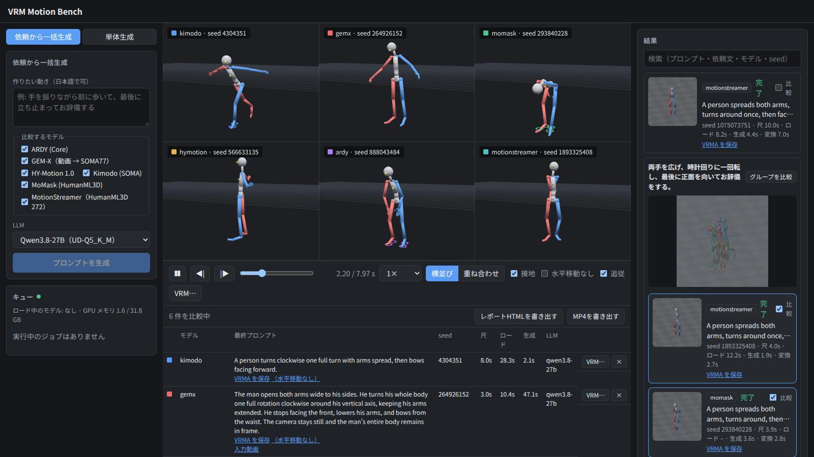
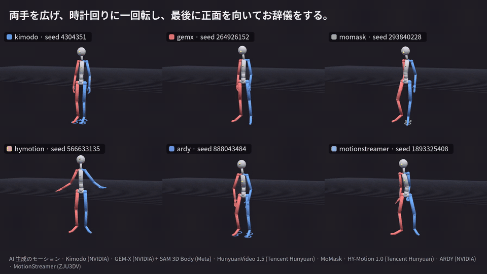

# VRM Motion Bench

[English](README.md) | 日本語

ローカルで動く AI モーション生成モデルの出力を、ブラウザ上で VRM に適用して比べる検証ツールです。テキスト・動画・音声・音楽から 8 つのモデルでモーションを作り、棒人間やお手持ちの VRM 1.0 で横並び・重ね合わせにして同期再生できます。





## できること

- **複数モデルの一括生成**：日本語で書いた「作りたい動き」から、LLM（Qwen3.8-27B）がモデルごとの書き方に合わせた英語のプロンプトと尺を作り、まとめて生成する
- **VRM で比較**：Blender（VRM Add-on）で VRM 1.0 の正規化ボーンにリターゲットし、VRMA にして three-vrm で再生する。横並び／重ね合わせ、共通タイムライン、接地マーカー、入力音声の同期再生、ユーザーの VRM への差し替え
- **seed 違いの比較**：同じ入力で seed だけ変えて最大 8 件を生成し、比較グループにまとめる
- **水平移動なし**：腰の水平移動を止めて再生・保存する（固定カメラで顔を映し続けるアプリでの見え方の確認など）
- **書き出し**：VRMA（通常版と水平移動なし版）、オフラインで開けるレポート HTML、SNS 向けの比較動画（MP4。横長／縦長、クレジット入り）
- **アダプター方式**：モデルごとに Docker コンテナとマニフェストを用意し、新しいモデルを差し込みやすくしている。GPU のジョブはキューで 1 つずつ実行し、モデルの入れ替えは自動で行う

## 対応モデル

| モデル | 入力 | 出力（骨格） | VRAM（実測） | 重みのサイズ | ライセンスの要点 |
| --- | --- | --- | --- | --- | --- |
| [Kimodo](https://github.com/nv-tlabs/kimodo) | テキスト | SOMA77 | 約 16GB | 約 18GB（ARDY と共有） | NVIDIA Open Model License。テキストエンコーダに Llama 3（アクセス申請が必要） |
| [ARDY](https://github.com/nv-tlabs/ARDY) | テキスト | SOMA（Core） | 約 16GB | （Kimodo と共有） | NVIDIA Open Model Agreement。Llama 3 は Kimodo と同じ |
| [MoMask](https://github.com/EricGuo5513/momask-codes) | テキスト | HumanML3D 22 関節 | CPU で動く | 約 0.5GB | MIT（コード）。学習データは非商用 |
| [HY-Motion 1.0](https://github.com/Tencent-Hunyuan/HY-Motion-1.0) | テキスト | SMPL-H 22 関節 | 約 22GB | 約 21GB | Tencent HY-Motion Community License（EU・英国・韓国では適用外） |
| [MotionStreamer](https://github.com/zju3dv/MotionStreamer) | テキスト（尺はモデルが決める） | SMPL-X 22 関節 | 約 20GB | 約 11GB | Project Registration License（個人の検証は登録不要）。学習データは学術用途 |
| [GEM-X](https://github.com/NVlabs/GEM-X) | 動画、またはテキスト（HunyuanVideo 1.5 で動画を作る） | SOMA77 | 約 12GB（動画生成は約 16GB） | 約 7.5GB＋動画生成 約 57GB | NVIDIA Open Model License。動画生成は Tencent Hunyuan Community License |
| [EMAGE](https://github.com/PantoMatrix/PantoMatrix) | 音声 | SMPL-X（体・指・顎）＋口の表情 | 約 0.7GB | 約 0.7GB | 重みは Apache 2.0。SMPL-X は非商用 |
| [EDGE](https://github.com/Stanford-TML/EDGE) | 音楽 | SMPL 24 関節＋接地フラグ | 約 12.5GB | 約 11GB | MIT。Jukebox の重みは非商用 |
| [Qwen3.8-27B](https://huggingface.co/unsloth/Qwen3.8-27B-GGUF)（プロンプト支援） | 日本語の依頼 | — | 約 23GB | 約 19GB | Apache 2.0 |

VRAM は RTX 5090（32GB）での実測です。GPU のモデルは 1 つずつ読み込むので、必要な VRAM は一番大きいモデルで決まります。各モデルの詳しい扱いは [docs/spec.md](docs/spec.md) の「初期アダプター候補」にあります。

## 動作環境

| 項目 | 内容（動作確認した環境） |
| --- | --- |
| OS | Linux x86_64（Ubuntu 26.04） |
| GPU | NVIDIA の GPU。24GB 以上を推奨（RTX 5090 32GB で確認）。CUDA 12.8 以降に対応したドライバ（595.99 で確認） |
| メモリ | 64GB 以上を推奨（HunyuanVideo 1.5 は重みを CPU に退避しながら動く。128GB で確認） |
| ディスク | 全モデルで重み約 150GB ＋ Docker イメージ約 75GB。使うモデルだけ用意すればよい |
| ソフトウェア | Docker ＋ [NVIDIA Container Toolkit](https://docs.nvidia.com/datacenter/cloud-native/container-toolkit/)（Docker 29 で確認）、[uv](https://docs.astral.sh/uv/)（Python 3.11 以上）、Node.js 20 以上（24 で確認）、ffmpeg（ホストに必要。アップロードの確認と比較動画の書き出しに使う）、[Hugging Face CLI](https://huggingface.co/docs/huggingface_hub/guides/cli)（`hf`） |
| アカウント | Hugging Face のアカウント。Kimodo・ARDY を使う場合は [meta-llama/Meta-Llama-3-8B-Instruct](https://huggingface.co/meta-llama/Meta-Llama-3-8B-Instruct) のアクセス申請（承認制）と `HF_TOKEN` |
| ライセンスへの同意 | EMAGE は SMPL-X のモデルを使う。[SMPL-X の利用規約](https://smpl-x.is.tue.mpg.de/modellicense.html)（非商用）に同意したうえで使う |

バックエンドは GPU 機で動かし、LAN 内の別端末のブラウザから使う想定です。**認証はないので、インターネットに公開しないでください。**

## 始め方

```bash
git clone https://github.com/arianpg/vrm-motion-bench.git && cd vrm-motion-bench

# Python（uv ワークスペース）とフロントエンド（レポートのテンプレートもビルドする）
uv sync --all-packages
(cd frontend && npm install && npm run build:report)

# 共通コンバーター（Blender ＋ VRM Add-on）のイメージ
docker build -f converter/Dockerfile -t vmb-converter .

# 使うモデルのイメージと重みを用意する（下の「モデルごとの準備」）。
# まず試すなら、CPU で動き重みも小さい MoMask がおすすめ

# 起動
uv run --package vmb-backend vmb-backend      # http://0.0.0.0:8800（起動時にコンバーターのコンテナも立ち上がる）
(cd frontend && npx vite --host)              # http://<GPU機>:5173 をブラウザで開く
```

重みのないモデルは、画面に入手手順が表示され、生成できない状態になります。

## モデルごとの準備

Docker イメージのビルドコンテキストはリポジトリのルートです。重みは `models/<アダプター ID>/` に置きます（Git 管理外）。

<details>
<summary>Kimodo・ARDY（テキスト）</summary>

```bash
docker build -f adapters/kimodo/docker/Dockerfile -t vmb-adapter-kimodo .
docker build -f adapters/ardy/docker/Dockerfile -t vmb-adapter-ardy .

# Kimodo の重み（初回起動時にも自動で取得されるが、事前に置いておくと速い）
#   Llama-3-8B-Instruct は Hugging Face でのアクセス申請と HF_TOKEN が必要
export HF_HOME=$PWD/models/kimodo/hf
hf download nvidia/Kimodo-SOMA-RP-v1.1
hf download McGill-NLP/LLM2Vec-Meta-Llama-3-8B-Instruct-mntp
hf download McGill-NLP/LLM2Vec-Meta-Llama-3-8B-Instruct-mntp-supervised
hf download meta-llama/Meta-Llama-3-8B-Instruct --exclude 'original/*'
unset HF_HOME

# ARDY の重み。テキストエンコーダ（LLM2Vec / Llama-3-8B）は Kimodo と同じなので、
# 同じディスク上ならハードリンクで共有する（容量を使わない）
mkdir -p models/ardy/hf/hub
cp -al models/kimodo/hf/hub/blobs models/kimodo/hf/hub/models--McGill-NLP--* \
       models/kimodo/hf/hub/models--meta-llama--* models/ardy/hf/hub/
HF_HOME=$PWD/models/ardy/hf hf download nvidia/ARDY-Core-RP-20FPS-Horizon40
```
</details>

<details>
<summary>MoMask（テキスト、CPU）</summary>

```bash
docker build -f adapters/momask/docker/Dockerfile -t vmb-adapter-momask .

# Google Drive（公式の prepare/download_models.sh と同じファイル）
mkdir -p models/momask/checkpoints/t2m && cd models/momask/checkpoints/t2m
uvx gdown 1vXS7SHJBgWPt59wupQ5UUzhFObrnGkQ0 -O humanml3d_models.zip && unzip humanml3d_models.zip && rm humanml3d_models.zip
cd -   # CLIP（ViT-B/32）は初回起動時に models/momask/clip へ自動でダウンロードされる
```
</details>

<details>
<summary>HY-Motion 1.0（テキスト）</summary>

```bash
docker build -f adapters/hymotion/docker/Dockerfile -t vmb-adapter-hymotion .

# 重みとテキストエンコーダ（CLIP-L、Qwen3-8B）。合わせて約 22GB
export HF_HOME=$PWD/models/hymotion/hf
hf download tencent/HY-Motion-1.0 --include 'HY-Motion-1.0/*' --local-dir models/hymotion/ckpts/tencent
hf download openai/clip-vit-large-patch14 --exclude '*.msgpack' --exclude '*.h5' --exclude 'pytorch_model.bin'
hf download Qwen/Qwen3-8B
unset HF_HOME
```
</details>

<details>
<summary>MotionStreamer（テキスト）</summary>

```bash
docker build -f adapters/motionstreamer/docker/Dockerfile -t vmb-adapter-motionstreamer .

# 重みと、テキストエンコーダ sentence-T5-XXL（約 9.7GB）。合わせて約 11GB
export HF_HOME=$PWD/models/motionstreamer/hf M=models/motionstreamer
hf download lxxiao/MotionStreamer Causal_TAE/net_last.pth Experiments/t2m_model/latest.pth --local-dir $M/ckpts
hf download lxxiao/272-dim-HumanML3D --repo-type dataset --include 'mean_std/*' --local-dir $M/ckpts/humanml3d_272
hf download sentence-transformers/sentence-t5-xxl --exclude pytorch_model.bin --exclude '2_Dense/pytorch_model.bin' \
   --local-dir $M/sentencet5-xxl   # 止まる場合は curl -r で分割して並列に取得し、sha256 を確かめる
unset HF_HOME M
```
</details>

<details>
<summary>GEM-X（動画）と、テキストから入力動画を作る HunyuanVideo 1.5</summary>

```bash
docker build -f adapters/gemx/docker/Dockerfile -t vmb-adapter-gemx .
docker build -f adapters/hyvideo/docker/Dockerfile -t vmb-adapter-hyvideo .   # テキスト入力を使う場合

# GEM-X（動画 → SOMA77）。SAM 3D Body の重みを含む。合わせて約 7GB
export HF_HOME=$PWD/models/gemx/hf I=models/gemx/inputs
hf download nvidia/GEM-X gem_soma.ckpt --local-dir $I/pretrained
hf download nvidia/GEM-X vitpose.pth --local-dir $I/checkpoints/vitpose
hf download nvidia/GEM-X sam3d_body.ckpt model_config.yaml --local-dir $I/checkpoints/sam-3d-body-dinov3
hf download nvidia/GEM-X mhr_model.pt --local-dir $I/mhr_data
hf download nvidia/GEM-X scale_mean.pth scale_comps.pth --local-dir $I/soma_data
unset HF_HOME I

# HunyuanVideo 1.5（I2V、480p ステップ蒸留版）。合わせて約 55GB
#   画像エンコーダ（SigLIP）は、公式手順の FLUX.1-Redux-dev（ゲート付き）の代わりに同じ構成の公開版を使う
export HF_HOME=$PWD/models/hyvideo/hf C=models/hyvideo/ckpts
hf download tencent/HunyuanVideo-1.5 --include 'config.json' --include 'scheduler/*' --include 'vae/*' \
   --include 'transformer/480p_i2v_step_distilled/*' --local-dir $C
hf download Qwen/Qwen2.5-VL-7B-Instruct --local-dir $C/text_encoder/llm
hf download google/byt5-small --exclude '*.msgpack' --exclude '*.h5' --local-dir $C/text_encoder/byt5-small
hf download nlpcvcode/Glyph-SDXL-v2 --include 'assets/*.json' --include 'checkpoints/byt5_model.pt' --local-dir $C/text_encoder/Glyph-SDXL-v2
hf download google/siglip-so400m-patch14-384 config.json model.safetensors --local-dir $C/vision_encoder/siglip/image_encoder
hf download google/siglip-so400m-patch14-384 preprocessor_config.json --local-dir $C/vision_encoder/siglip/feature_extractor
unset HF_HOME C
```
</details>

<details>
<summary>EMAGE（音声）</summary>

```bash
docker build -f adapters/emage/docker/Dockerfile -t vmb-adapter-emage .

# 重みと SMPL-X のモデル（骨格と口の動きの計算に使う。SMPL-X の利用規約に同意のうえで）。合わせて約 750MB
HF_HOME=$PWD/models/emage/hf hf download H-Liu1997/emage_audio
HF_HOME=$PWD/models/emage/hf hf download H-Liu1997/emage_evaltools smplx_models/smplx/SMPLX_NEUTRAL_2020.npz \
   --local-dir models/emage/evaltools
```
</details>

<details>
<summary>EDGE（音楽）</summary>

```bash
docker build -f adapters/edge/docker/Dockerfile -t vmb-adapter-edge .

# チェックポイント（Google Drive、約 1.2GB）と Jukebox 5B の重み（約 10GB）
uvx gdown 1BAR712cVEqB8GR37fcEihRV_xOC-fZrZ -O models/edge/checkpoint.pt
mkdir -p models/edge/jukemirlib && cd models/edge/jukemirlib
J=https://openaipublic.azureedge.net/jukebox/models/5b
curl -fO $J/vqvae.pth.tar && curl -fO $J/prior_level_2.pth.tar   # 遅い場合は curl -r で分割して並列に取得し、Content-MD5 を確かめる
cd -
```
</details>

<details>
<summary>プロンプト支援の LLM（Qwen3.8-27B）</summary>

```bash
docker pull ghcr.io/ggml-org/llama.cpp:server-cuda13
hf download unsloth/Qwen3.8-27B-GGUF Qwen3.8-27B-UD-Q5_K_M.gguf --local-dir models/llm/qwen3.8-27b
```

LLM の設定は `config/llm.yaml` にあります。
</details>

## 使い方

1. **依頼から一括生成**：「作りたい動き」を日本語で書き、比較するモデルを選んで「プロンプトを生成」。LLM が作ったプロンプトと尺を確認・手直しして確定すると、全モデル分がキューに入り、終わると比較ビューで開く
2. **単体生成**：モデルを選んで入力（テキスト・動画・音声・音楽）を与える。seed 違いの比較もここから
3. **比較**：結果一覧の「比較」にチェックを入れるか、「グループを比較」を押す。VRM ファイルをドラッグ＆ドロップすると、そのモデルで再生する
4. **保存**：比較表の「VRMA を保存」、比較バーの「レポートHTMLを書き出す」「MP4を書き出す」

## 構成

| ディレクトリ | 内容 |
| --- | --- |
| `backend/` | オーケストレーター（FastAPI）。ジョブキュー、アダプター・LLM コンテナの起動・停止、SSE、レポート・比較動画の生成 |
| `frontend/` | React ＋ three-vrm の画面と、レポート HTML のテンプレート |
| `adapters/<id>/` | アダプター（`manifest.yaml`、`bone_map.yaml`、Docker イメージ） |
| `converter/` | 共通コンバーター（Blender 常駐。リターゲット → VRMA・BVH・プレビュー WebP） |
| `packages/sourcemotion/` | 共通のモーション形式（SourceMotion NPZ）の読み書きとリターゲットの計算（numpy のみ） |
| `packages/adapter_kit/` | アダプター共通の HTTP サーバー（`/health`、`/generate`、`/progress`） |
| `config/llm.yaml` | プロンプト支援に使う LLM（llama-server）の設定 |
| `assets/` | 棒人間 VRM（`tools/stickman/build_stickman.py` で生成）と動画生成の開始画像 |
| `docs/` | 仕様書、ライセンス一覧、調査メモ |
| `tests/fixtures/adapters/dummy/` | パイプライン検証用のダミーアダプター |

実行時のデータは `data/`、モデルの重みは `models/` に置きます（どちらも Git 管理外）。

主な環境変数：`VMB_DATA_DIR`、`VMB_MODELS_DIR`、`VMB_ADAPTERS_DIR`、`VMB_PORT`（既定 8800）、`VMB_GPU_INDEX`、`HF_TOKEN`。`VMB_CONVERTER_URL` を指定すると、コンテナの代わりにホストで動かしている変換ワーカーを使います（開発用）。

ダミーアダプターも使う場合は、`adapters/` の各アダプターと `tests/fixtures/adapters/dummy` へのシンボリックリンクを置いたディレクトリを `VMB_ADAPTERS_DIR` に指定し、`docker build -f tests/fixtures/adapters/dummy/Dockerfile -t vmb-adapter-dummy .` でイメージを作ります。

## テスト

```bash
uv run --package sourcemotion --with pytest pytest -q packages/sourcemotion/tests
uv run --package vmb-backend --with pytest pytest -q backend/tests
(cd frontend && npx tsc -b --noEmit)
```

## ライセンス

このリポジトリのコードと同梱物（棒人間 VRM、開始画像など）は [MIT License](LICENSE) です。

各モデル・重み・学習データ・ボディモデルは、それぞれのライセンスに従います（このリポジトリには含めず、各自が取得します）。**非商用に限られるものが多く、生成したモーションを公開するときは「AI 生成」の明示などの条件があります。** 詳しくは [docs/licenses.md](docs/licenses.md) を読んでください。比較動画とレポート HTML には、使ったモデルのクレジットが自動で入ります。

## 謝辞

各モデルの作者の皆さまと、[three-vrm](https://github.com/pixiv/three-vrm)、[VRM Add-on for Blender](https://github.com/saturday06/VRM-Addon-for-Blender)、[Blender](https://www.blender.org/)、[llama.cpp](https://github.com/ggml-org/llama.cpp) に感謝します。
