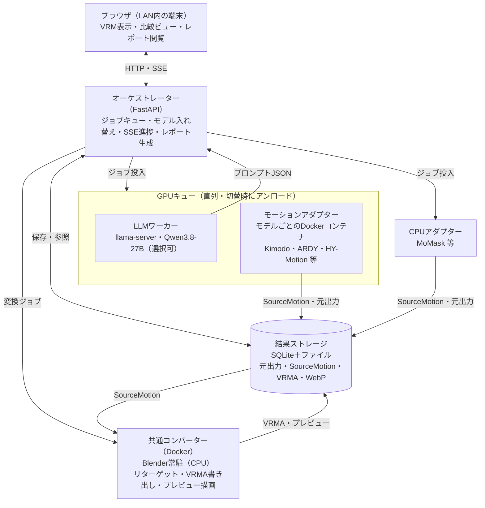

# VRM Motion Bench VRMモーション比較ツール 仕様書

Oct 10, 2026 · @arianpg（Oct 11, 2026 改訂）

## 目的とスコープ

ローカルで動くAIモーション生成モデルの出力を、ブラウザ上でVRMに適用して確認・比較するための**検証ツール**です。モデルはアダプター方式で追加でき、新しいモデルが出ても差し込みやすい構成にします。

- **対象**：テキスト・動画・音声など、各モデルが受け付ける入力からのモーション生成と、その結果の比較
- **利用形態**：GPU機（RTX 5090 32GB）上でバックエンドを動かし、LAN内の別端末のブラウザからアクセスする
- **対象VRM**：VRM 1.0 のみ（VRM 0.x は対象外）
- **スコープ外**：リアルタイム生成、ブラウザ内推論（WebGPU）、外部クラウドサービスの利用

## 決定事項一覧

| 項目 | 決定内容 |
| --- | --- |
| 推論の実行場所 | 全モデルともバックエンドで実行。WebGPUは使わない |
| モデルの実装単位 | モデルごとのアダプター。バックエンドはモデルごとのDockerコンテナ |
| マニフェスト | コンテナの外に静的ファイルとして置く。フォーム表示のためにコンテナを起動しない |
| GPU利用 | キューで直列実行。モデル変更時は前のモデルをアンロード |
| リアルタイム性 | 考慮しない。ARDYのストリーミングはアダプター内で吸収し、1本のクリップとして返す |
| アダプターの出力 | 元出力をそのまま保存したうえで、共通形式の SourceMotion NPZ を出力する。BVHは確認用の副産物 |
| リターゲット | Dockerで固定したBlender＋VRM Add-onで、棒人間VRMへワールド空間リターゲットし、VRMAを書き出す |
| プロンプト支援 | LLMがモデル別プロンプトガイドに沿ってプロンプトを生成。ガイドと検証ルールはマニフェストの `prompt` にまとめる |
| LLMの実行 | GPUで実行し、キュー上のワーカーとして扱う（ロード待ちは許容、精度重視） |
| LLMモデル | 選択可能。デフォルトは Qwen3.8-27B の量子化版 |
| 比較表示 | 横並び／重ね合わせ（半透明）を切り替え可能。共通タイムラインで同期再生 |
| タイムライン | 一番長いクリップに合わせてループ。短いクリップは最後のフレームで止めて待つ |
| 結果保存 | 生成結果を履歴として保存し、比較に使う。キューは永続化しない |
| プレビュー | 静止画サムネイルは作らない。Blenderで描画したアニメーションWebPをプレビューにする |
| レポート | 比較結果を1枚のHTMLとして出力。棒人間VRMを埋め込み、ユーザーVRMもインポート可能 |
| ネットワーク | バックエンドはGPU機、ブラウザはLAN越しにアクセス |

## システム構成



オーケストレーターがすべてのジョブを管理します。GPUを使うLLMとモーションアダプターは1本のキューで直列に動きます。CPUで動くアダプター（MoMask）と、CPU中心のBlender変換は、GPUキューとは別のワーカーで並行して動きます。

## アダプター仕様

アダプターは「入力を受けて推論し、元出力を保存し、共通形式の SourceMotion を返す」までを担当します。リターゲット、fpsの統一、VRMA書き出し、プレビュー描画は共通コンバーターに任せます。新モデルの追加作業を「コンテナ＋マニフェスト＋ボーン対応表」の3点に限定するのが狙いです。

### ディレクトリ構成

```
adapters/<adapter_id>/
  manifest.yaml     # オーケストレーターとフロントが読む（コンテナ外）
  bone_map.yaml     # 元骨格の関節名 → VRM 1.0 ヒューマノイドボーン名
  docker/           # Dockerfile など
```

マニフェストはコンテナの外にあるので、モデル選択やフォーム表示のためにGPUモデルを起動する必要はありません。

### マニフェスト

| フィールド | 内容 |
| --- | --- |
| `id` / `name` / `version` | 識別子と表示名 |
| `device` | `gpu` または `cpu`。`cpu` のアダプターはGPUキューに入れない |
| `inputs` | 入力欄の定義（JSON Schema）。フロントはこれからフォームを自動生成する。型は text／duration／seed／file(video・audio) など。将来の `segments[]`（テキストと尺の組の配列）に拡張できる形にする |
| `duration` | 秒単位の `min`／`max`／`step`、尺の自動決定に対応するか（`auto_supported`）。フレーム数への変換はアダプターが行う |
| `defaults` | 尺、サンプル数、seed などの既定値 |
| `prompt` | `llm_assist`（LLMでプロンプトを作るか。動画・音声入力のアダプターは false）、`guide`（LLM向けの自由記述）、`rules`（機械的にチェックできる制約） |
| `options` | モデル固有の設定。例：HY-Motion 内蔵のプロンプト書き直し（既定は無効） |
| `output` | 骨格の種類、fps、上方向の軸、単位、レスト姿勢、接地フラグの有無、表情の有無 |
| `assets` | 手動配置が必要なファイル。配置パス、種類（`hf_gated`／`manual_download`／`auto`）、入手手順、ライセンス |
| `resources` | VRAM目安、ロード時間の目安、タイムアウトの上書き、コンテナ名 |
| `license_note` | 重み・データのライセンス注記 |

**prompt.rules**

機械的に検証できる制約だけを置きます。種類は `language`、`starts_with`、`max_words`、`forbidden_terms`、尺の範囲などです。`rules` はLLMのシステムプロンプトにも自動で埋め込み、出力の検証にも使うので、制約の記述は1か所で済みます。「動作は1〜2個まで」「非対応の内容」のような意味の判断は `guide` に書き、LLMに任せます。

**マニフェスト例（Kimodo）**

```yaml
id: kimodo
name: Kimodo (SOMA)
version: 1.1
device: gpu
inputs:
  text: {type: text}
  duration: {type: duration}
  seed: {type: seed}
duration: {min: 1, max: 10, step: 0.1, auto_supported: false}
defaults: {duration: 5, num_samples: 1}
prompt:
  llm_assist: true
  guide: |
    Begin with "A person ...". Focus on one or at most two behaviors, with a medium level of detail.
    Supported: locomotion, gestures, everyday activities. Avoid sports or actions outside these categories.
  rules: {language: en, starts_with: "A person", max_words: 40}
output: {skeleton: soma77, fps: 30, up: Y, forward: +Z, unit: m, rest_pose: tpose, foot_contacts: true, expressions: false}
assets:
  - id: llama3-8b
    kind: hf_gated
    repo: meta-llama/Meta-Llama-3-8B-Instruct
    how_to: "Hugging Face でアクセス申請し、HF_TOKEN を設定する"
resources: {vram_gb: 17, load_time_s: 60}
license_note: "NVIDIA Open Model License"
```

`max_words` などの数値は仮の値で、評価セットで決めます。

### アダプターAPI

各コンテナは内部のDockerネットワーク上でHTTPサーバー（FastAPI）を公開します。モデルの重みはコンテナ起動時に読み込みます。

| エンドポイント | 内容 |
| --- | --- |
| `GET /health` | `starting`／`loading`／`ready` を返す。`ready` で起動完了 |
| `POST /generate` | ジョブID、入力、パラメータ、出力先を受け取り、完了まで応答を返さない。同時に1件だけ実行する |
| `GET /progress` | 任意。拡散ステップなどの進捗割合を返す |

**データの受け渡し**

- 共有ボリューム：`/data/jobs/{job_id}/input`（アップロードされた動画・音声）、`/data/jobs/{job_id}/output`（元出力と SourceMotion）
- 重み：`/models/{adapter_id}` を読み取り専用でマウント

**タイムアウトの既定値**（マニフェストの `resources` で上書き可能）

| 処理 | 既定値 |
| --- | --- |
| 起動から `ready` まで | ロード時間の目安×3。目安がなければ600秒。2秒ごとに health を確認 |
| 生成 | 600秒 |
| 変換 | 120秒 |
| LLM（思考モードON） | 300秒 |
| `docker stop` の猶予 | 30秒。過ぎたら強制終了 |

**エラー応答**：`missing_asset`、`invalid_input`、`oom`、`internal` のコードとメッセージを返します。

**アセットの事前確認**：オーケストレーターはコンテナを起動する前に、マニフェストの `assets` が配置されているかを確かめます。未配置なら起動せず、入手手順と配置先を画面に表示します。

### SourceMotion（アダプターの出力形式）

アダプターは元出力（NPZ／BVH／pkl など）を必ずそのまま保存したうえで、共通形式の **SourceMotion NPZ** を出力します。BVHはオイラー角のテキスト表現で、接地フラグ・ワールド座標・体型・表情を持てず、レスト姿勢の解釈もモデルごとに揺れるため、受け渡し形式には使いません。

**ファイル**：`/data/jobs/{job_id}/output/source_motion.npz`（`numpy.savez_compressed`）。読み込みは `allow_pickle=False` で行えること（辞書やオブジェクト配列は入れない）。

**共通規約**

| 項目 | 規約 |
| --- | --- |
| 数値型 | 浮動小数は float32、インデックスは int32 |
| クォータニオン | **xyzw（スカラー最後）**、正規化済み。glTF／VRMA／three.js／scipy と同じ並び。符号の連続性（q と -q の反転）はコンバーターが補正する |
| 長さの単位 | **メートル**。cm 等で出力するモデルはアダプターで換算する |
| 座標系 | 右手系。上方向と前方向はモデルの元のままで、`up_axis`／`forward_axis` に明記する。軸の変換はコンバーターが一元的に行う |
| 関節の並び | トポロジカル順（親のインデックス < 子のインデックス）。ルートは index 0 で親は -1 |
| 回転の意味 | `local_rotations` は親座標系での**絶対的な**ローカル回転（レスト姿勢からの差分ではない）。レスト時は `rest_rotations` と一致する |
| 位置の計算 | 関節のワールド位置 = 親のワールド位置 + 親のグローバル回転 × `offsets[j]`。ルートだけは `root_translation[t]` をワールド位置とする |
| 地面 | 地面は up 軸の 0。`offsets[0]` はレスト姿勢でのルートの位置で、足裏が地面に接する高さに置く（腰の高さの比で縮尺するときの基準になる） |

**キー**（T = フレーム数、J = 関節数）

| キー | 形状・型 | 必須 | 内容 |
| --- | --- | --- | --- |
| `format_version` | 文字列スカラー | ○ | `"1"` |
| `joint_names` | [J] 文字列 | ○ | 関節名。`bone_map.yaml` のキーと一致させる |
| `parents` | [J] int32 | ○ | 親のインデックス（ルートは -1） |
| `offsets` | [J, 3] float32 | ○ | レスト姿勢での親からのオフセット（親のローカル座標系、m） |
| `rest_rotations` | [J, 4] float32 | ○ | レスト姿勢のローカル回転 |
| `local_rotations` | [T, J, 4] float32 | ○ | 各フレームのローカル回転 |
| `root_translation` | [T, 3] float32 | ○ | ルート関節のワールド位置（m） |
| `fps` | float32 スカラー | ○ | フレームレート |
| `up_axis` / `forward_axis` | 文字列スカラー | ○ | `"+Y"`、`"+Z"`、`"-Y"` など |
| `rest_pose_kind` | 文字列スカラー | ○ | `"tpose"`／`"apose"`／`"other"`（情報用。補正自体は回転で行う） |
| `foot_contacts` | [T, K] bool | | 接地フラグ |
| `contact_joint_names` | [K] 文字列 | | 接地フラグの対象関節（`foot_contacts` があれば必須） |
| `expression_names` / `expression_weights` | [E] 文字列 / [T, E] float32 | | 表情（将来用の予約） |
| `meta_json` | 文字列スカラー | ○ | JSON文字列。アダプターID・バージョン、最終プロンプト、seed、元出力のファイル名、生成日時 |

**共通ライブラリ**：読み書きと検証（形状・正規化・トポロジカル順のチェック）、BVH → SourceMotion NPZ の変換を、アダプターとコンバーターで共有する Python パッケージとして用意します。BVHを直接出すモデル（MoMask）はこれを使って変換します。ボーン対応表は `bone_map.yaml` から読みます。

### 責務分担

| 処理 | 担当 |
| --- | --- |
| 入力の受け付けと前処理 | アダプター |
| 推論の実行（ARDYのストリーミングはここで吸収） | アダプター |
| 元出力の保存と SourceMotion NPZ の出力 | アダプター |
| ボーン対応表の提供 | アダプター（`bone_map.yaml`） |
| 基準モデルへのリターゲット、レスト姿勢の補正、腰の移動量の縮尺 | 共通コンバーター |
| fps の統一と VRMA 書き出し | 共通コンバーター |
| 確認用BVH、プレビューWebP、接地フラグ（contacts.json）の作成 | 共通コンバーター |

## 共通コンバーター

Dockerコンテナで動かし、Blender の公式ビルド（numpy 同梱）と VRM Add-on for Blender のバージョンを固定します（Blender 5.0.1、VRM Add-on 4.7.2）。`blender --background` を常駐させ、HTTP（`POST /convert`）でジョブを 1 件ずつ受け付けるワーカーにします。

リターゲットの計算は numpy だけの共通ライブラリ（`sourcemotion.retarget`）で行い、Blender の外で単体テストできるようにしています。結果は「VRM 正規化ボーン」（各ボーンのレスト時のワールド回転を単位元とみなしたローカル回転）と hips の位置で、Blender 側はこれを棒人間のポーズに変換してキーフレームにし、VRM Add-on で VRMA を書き出します。

**リターゲットの方式**

- 回転はワールド空間で移す：対象のグローバル回転 = 元のグローバル回転 × 元のレスト姿勢の逆 × 対象のレスト姿勢。レスト姿勢（T／Aポーズ）や骨のローカル軸の違いを吸収し、対応先のない中間関節は自然に飛ばされる
- 対応先のない関節は捨てる。指は元骨格にあれば（SOMA77、SMPL-X）VRMの指ボーンに割り当て、なければレスト姿勢のまま
- 目はVRMAのヒューマノイドに含められないため対象外。表情は将来の拡張とする
- 腰（hips）の移動量は、元骨格と棒人間の腰の高さの比で縮尺する。再生時は three-vrm-animation が「読み込むモデルの腰の高さ ÷ VRMAのレスト時の腰の高さ」で自動的に縮尺するため、ユーザーVRMへの縮尺は不要
- 接地フラグがある場合は、接地フレームで足の高さが0になるように腰の高さを補正する（任意）
- 30fpsにリサンプリングし、VRMAに書き出す。VRMAは hips 以外に移動量を持たず、スケールも持たない（VRMA 1.0 仕様）

**プレビュー**

変換直後の同じBlenderセッションで、棒人間にVRMAを当てて Workbench で描画し、アニメーションWebP（15fps、320px、床は市松模様、カメラは腰の水平位置を追う）にまとめます。比較グループの全結果が揃い、2件以上が完了した時点で、各結果を色違い・半透明で重ねたグループプレビュー（`group_preview` ジョブ）も作ります。色の順は比較ビューと同じ（作成順）です。この仕組みは将来の自動評価（Qwenに動画を見せる）でも使います。

**接地フラグ**

SourceMotion に接地フラグがあれば、VRM の足のボーン（対応表に載っていない関節は最も近い祖先）に対応付けて30fpsにし、`contacts.json` として書き出します。ビューアはこれを使って接地マーカーを出します。

## 棒人間VRM

基準モデルとして、VRM 1.0 の棒人間を用意しています。

- ファイル：`assets/stickman/stickman.vrm`（約590KB）
- 生成スクリプト：`tools/stickman/build_stickman.py`（`blender -b --python-use-system-env --python tools/stickman/build_stickman.py -- --out assets/stickman/stickman.vrm`）
- 構成：VRM Add-on の基本アーマチュア（Tポーズ、身長1.70m、ヒューマノイドボーン53本・指を含む）に、円柱と関節球を剛体ウェイトで割り当てたメッシュ
- 色分け：キャラクターの左が青、右が赤、体幹が灰色。顔と胸の正面に向きを示す黄色のマーカー
- マテリアルは MToon ではなく通常の glTF マテリアル（半透明表示を簡単にするため）

## ジョブ・キュー・モデル切り替え

GPUを使うジョブ（LLM・GPUアダプター）は1本のキューで直列に実行し、モデルが変わるときだけ入れ替えます。

- **ジョブ種別**：`llm_prompt`（プロンプト生成）、`motion`（モーション生成）、`convert`（VRMA変換とプレビュー）、`group_preview`（比較グループの重ね合わせプレビュー）
- **ジョブの連鎖**：`motion` は SourceMotion を保存した時点で終わり、`convert` が自動で投入される。比較グループの全 `convert` が終わると `group_preview` が投入される
- **表示上の状態**：生成結果1件ごとに queued → loading → running → converting → done／failed と表示する。converting は `convert` ジョブの実行中を指す。ロード待ちが長いので loading は独立した状態として表示する
- **モデル切り替え**：使用中と異なるモデルのジョブを実行するときは、現在のコンテナを停止（＝アンロード）し、NVMLでGPUメモリの解放を確認してから次を起動する
- **並べ替え**：待機中のジョブは同じモデルのものをまとめて実行し、入れ替え回数を減らす。ただし依存関係（プロンプト確定 → モーション生成）は崩さない
- **CPUジョブ**：`convert`、`group_preview`、CPUアダプター（MoMask）の `motion` は、GPUキューとは別のワーカーで並行実行する
- **進捗通知**：SSE でフロントへ状態と進捗を送る
- **失敗時**：ログと元出力を保存し、同じ条件で再実行できるようにする
- **再起動時**：キューは永続化しない。オーケストレーターの起動時に、実行中だったジョブを failed（中断）にし、残っているアダプターのコンテナを停止する

### 結果の保存

SQLite のメタデータとファイル群で管理します。1件ごとに次を保存します。

- 元の依頼文、LLMが生成したプロンプト、最終プロンプト（手直し後）
- 使用LLM、モーションモデル、パラメータ、seed
- ロード時間と生成時間（残り時間の見積もりにも使う）
- 元出力、SourceMotion NPZ、確認用BVH、VRMA、プレビューWebP、接地フラグ（あれば）
- 比較グループID（同じ依頼から一括生成した結果を束ねる）と、グループプレビューWebP

## LLMプロンプト支援

日本語で書いた「作りたい動き」から、選んだアダプターそれぞれのガイドに沿った英語プロンプトと尺を、LLMが一括生成します。精度を優先し、GPUで実行します。対象は `prompt.llm_assist` が true のアダプター（テキスト入力のもの）だけで、動画・音声入力のアダプターにはプロンプトを作りません。

**流れ**

1. ユーザーが依頼文を入力し、比較したいアダプターを複数選ぶ
2. テキスト入力のアダプターごとに `llm_prompt` ジョブをキューへまとめて投入する
3. LLMが `guide` と `rules`（システムプロンプト）に沿ってプロンプト・尺・補足をJSONで返す
4. `rules` で検証し、NGなら理由を添えて再生成させる。再生成は同じ `llm_prompt` ジョブの中で繰り返し、LLMをロードし直さない（上限は暫定で3回。初回と合わせて最大4回生成し、すべてNGなら最後の結果に違反理由を付けて画面に出す）
5. 画面で確認・手直しして確定すると、`motion` ジョブが投入される

**LLMの実行環境**

- llama-server（OpenAI互換API）をワーカーコンテナとして動かす
- デフォルトは [Qwen3.8-27B](https://huggingface.co/Qwen/Qwen3.8-27B) の量子化版。unsloth の UD-Q5\_K\_M（19.8GB）を使う
- 思考モードはON。思考トークンの上限は暫定で4096、回答部分の上限は1024トークン
- 出力形式は llama-server の `json_schema` で強制する（思考モードとの併用時の挙動は実装時に検証する）

**LLMの選択**

- 設定ファイル（`config/llm.yaml`）にモデルごとのGGUFパス、コンテキスト長、サンプリング設定、思考モードの有無、思考トークンの上限を登録する
- ガイドはアダプター側にあるので、LLMを替えてもガイドは変更不要
- 使用LLMは結果に記録し、LLM同士の比較にも使えるようにする

## フロントエンド：画面構成と比較ビュー

React と three.js／three-vrm／three-vrm-animation で構成し、VRM表示部を中心に置きます。

| 画面要素 | 内容 |
| --- | --- |
| VRM表示部 | VRMの表示とVRMA再生。床グリッド、接地マーカー（接地フラグがあるモデルのみ）、カメラ操作 |
| モデル選択部 | アダプター一覧。選ぶと、そのモデルが受け付ける入力欄がマニフェストから自動生成される。アセット未配置のアダプターには入手手順を表示する |
| 入力・プロンプト欄 | 依頼文、LLMによるプロンプト生成、生成結果の確認・手直し、尺・seed などのパラメータ |
| キュー表示 | 結果ごとの状態、ロード中のモデル、進捗、過去の実績から見積もった残り時間 |
| 履歴 | 過去の結果の一覧と検索。プレビューWebPを表示し、比較対象として選択 |
| 比較ビュー | 複数の結果を共通タイムラインで同期再生 |

**比較ビュー**

- 表示形式：横並び（ビューポート分割）と重ね合わせ（半透明）を切り替え可能
- 共通タイムラインで再生・一時停止・コマ送り・速度変更
- タイムラインの長さは一番長いクリップに合わせる。短いクリップは最後のフレームで止めて待ち、全体を一番長いクリップの周期でループする
- 各結果のメタデータ（モデル、プロンプト、seed、生成時間）を並べて表示
- 同じ依頼から全アダプター分を一括生成する「比較グループ」単位で開ける

**VRMモデル**

- 既定は棒人間VRM（左右で色分け）
- ユーザーのVRMをファイル選択／ドラッグ＆ドロップで読み込み可能。全ビューポートに適用するか、ビューポートごとに差し替えるかを選べる
- VRM 1.0 のみ対応する。VRM 0.x のファイルが読み込まれた場合はエラーメッセージを出す

## レポートHTML出力

比較結果を、ネット接続なしで開ける1枚のHTMLとして書き出します。アプリ本体の比較ビューと同じコンポーネントを「データ埋め込み版」としてビルドし、実装の重複を避けます。

**埋め込むもの**

- VRMA（base64）：10秒・30fps で1本あたり概算350KB前後
- 棒人間VRM（テクスチャなし、約590KB）
- メタデータ：依頼文、LLM生成プロンプト、最終プロンプト、使用LLM、モデル、パラメータ、seed、生成時間
- ビューアのJS（three.js 等をバンドルして同梱、1MB前後）

**機能**

- 横並び／重ね合わせの切り替え、共通タイムラインでの同期再生
- ユーザーのVRMをドラッグ＆ドロップで読み込み、実モデルで確認できる（読み込みはブラウザ内で完結し、HTMLには保存しない）

**ビルド方式**

Vite と vite-plugin-singlefile で JS・CSS をインライン化したテンプレート（`npm run build:report`）を作り、データはテンプレートに JSON として差し込みます。サーバー側に、比較中の結果（同じグループでなくてもよい）から HTML を生成するエンドポイント（`GET /api/report?ids=...`）を用意します。接地フラグがあれば一緒に埋め込みます。

## 初期アダプター候補

最初は Kimodo で一連の流れ（生成 → SourceMotion → Blender → VRMA → 表示）を通し、その後に他のモデルを足す順番を想定しています。Kimodo が RTX 5090 で動かないと分かった場合は、Kimodo のアダプターは断念し、基準実装を ARDY（同じ NVIDIA 系で NPZ 形式も近い）に移します。

| アダプター | 入力 | 元骨格・出力 | fps | 実行 | VRAM目安 | 優先度 |
| --- | --- | --- | --- | --- | --- | --- |
| Kimodo | テキスト（＋拘束は将来） | SOMA77。NPZ（回転・接地フラグ）／BVH | 30 | GPU | 約16GB（実測。テキストエンコーダをCPUにすると3GB未満） | 1（基準実装） |
| ARDY | テキスト | Core骨格（cskel27、指なし）。NPZ（回転・接地フラグ） | 20 | GPU | 約16GB（実測。テキストエンコーダは Kimodo と同じ重みをハードリンクで共有） | 2（実装済み。SOMA 版は未公開のため Core 版を使う） |
| MoMask | テキスト | HumanML3D 22関節 → 付属の IK で BVH（SMPL 系の関節名） | 20 | CPU | なし（CPU で読み込み約7秒、6秒のモーションを約10〜20秒で生成） | 2（実装済み。軽量な比較対象） |
| HY-Motion 1.0 / Lite | 英語テキスト | SMPL-H 系の体 22 関節（6D 回転）。同梱の木製人形モデルの骨格を使う | 30 | GPU | 実測で約22GB（Qwen3-8B と CLIP-L を含む。公称は 26GB／24GB） | 3（1.0 を実装済み。Lite は `HYMOTION_VARIANT` で切り替え可能） |
| GEM-X | 動画 | SOMA77（軸角度・体型・ルート移動量） | 未確認 | GPU | 未確認 | 4（動画入力の最初の1本） |
| EMAGE | 音声 | SMPL-X＋FLAME（NPZ） | 30 | GPU | 未確認 | 5 |
| EDGE | 音楽 | SMPL（関節位置、pkl）。Jukebox特徴抽出が必要 | 未確認 | GPU | 16GB以上 | 5 |

**プロンプトの要点（調査結果）**

- **Kimodo**：「A person …」で始める。動作は1〜2個まで、詳しさは中程度。学習済みの範囲（歩行・ジェスチャー・日常動作）を外れると品質が落ちる。1プロンプトあたり最大10秒
- **ARDY**：「A person walks in a circle.」のような短文。既定の尺は5秒。自己回帰で任意の長さを作れるが、学習時の窓が10秒なので比較用には10秒までとし、履歴の長さは窓に収まる最長に固定する。指の関節がないので手指の細かい指示は書かない
- **MoMask**：HumanML3D 形式（「A person is …」）。尺はフレーム数（20fps、4の倍数、最大196フレーム＝9.8秒）で、尺を省くとモデルが長さを推定する。関節位置しか出力しないため、付属の IK（Joint2BVHConvertor）で BVH にしてから SourceMotion にする（関節位置との誤差は平均約2cm）。接地フラグは特徴量の末尾4次元を使う
- **HY-Motion**：英語で60語未満。手足と体幹の動きに集中する。動物、感情・服装・外見、環境・物体・カメラ、複数人、ループ、その場での動作は非対応。モデル内蔵のLLMによるプロンプト書き直しと尺推定は、VRAM節約と比較条件の統一のため使わない。尺は最大12秒（360フレーム）。出力の関節位置（keypoints3d）は移動量を含まないため、腰の位置は「移動量（transl）＋レスト時の腰の位置」で求める

調査レポートでの整理と同じく、ライセンスは個人の検証用途を前提にしています。

## 実装時の確認事項

設計に影響しうるため、実装と並行して早い段階で確認します。

| 確認内容 | 合格条件 | 不可の場合 | 結果（2026-10-11） |
| --- | --- | --- | --- |
| Kimodo が RTX 5090 で動くか（CUDA 12.8 以降の PyTorch でコンテナを構築） | GPU上で10秒のモーションを生成できる | Kimodo のアダプターを断念し、基準実装を ARDY に移す | **合格**。`pytorch/pytorch:2.8.0-cuda12.8` ベース。ロード約22秒、VRAM 約16GB、10秒のモーションを約2.3秒で生成 |
| GPUのないコンバーターのコンテナで、Blender Workbench のヘッドレス描画ができるか | プレビューWebPを書き出せる | Mesa のソフトウェア描画（llvmpipe）や EGL を導入する。それでも不可ならコンテナにGPUを割り当てる | **合格**。Mesa（llvmpipe）の EGL で描画できる（EGL の警告は出るが出力は正常）。5秒のクリップの変換とプレビューで約4〜6秒 |
| llama-server で思考モードと `json_schema` を併用できるか | 思考を経たうえで、スキーマどおりのJSONが返る | 思考モードをOFFにする、または思考後の出力をパースして検証する | **合格**。llama-server（`server-cuda13`）＋ Qwen3.8-27B UD-Q5_K_M で、思考（`--reasoning-budget 4096`）を経たうえでスキーマどおりの JSON が返った。読み込み約4秒（OS キャッシュあり）、1件あたり約6〜15秒 |
| `docker stop` 後に NVML でGPUメモリの解放を検知できるか | 停止後、使用メモリが起動前の水準に戻ったことを検知できる | 待機時間の固定や、プロセス単位の確認など別の検知方法を使う | **合格**。Kimodo 停止後、17.5GB → 1.7GB に戻ったことを検知できた |

## 懸念点・未決事項

実装に影響が大きい順に並べています。

**技術的な懸念**

1. **古いモデルが新しいGPUで動かない可能性**：RTX 5090（Blackwell）は CUDA 12.8 以降でビルドされた PyTorch が必要です。Dockerで環境を分けても、コンテナ内の torch が古ければGPUでは動きません。MoMask（PyTorch 1.7.1）はCPU実行のアダプターにしました（PyTorch 2.8 の CPU 版で動作確認済み）。EDGE（PyTorch 1.12.1／CUDA 11.6）は torch の更新（移植）が必要です。
2. **骨格ごとのボーン対応とレスト姿勢**：SOMA77、Core、SMPL-H、SMPL-X、HumanML3D系BVHのそれぞれに対応表が必要です。Kimodo で最初に一本通し、リターゲットの仕組みを固めてから横展開します。
3. **手動ダウンロードが必要なアセット**：Kimodo／ARDY は Meta-Llama-3-8B-Instruct（Hugging Face でのアクセス申請とトークン設定）、EMAGE などは SMPL-X 等のボディモデル（登録と手動ダウンロード）が必要です。マニフェストの `assets` で管理し、未配置時は案内を出します。
4. **ストレージとロード時間**：Kimodo（約16GB）、Qwen3.8-27B（約20GB）、HY-Motion などで合計100GB規模になります。NVMe 上に置き、RAMに余裕があればOSのキャッシュでロード時間が縮みます。1つの依頼で N 個のアダプターを比較すると、LLMで1回、GPUアダプターで最大N回の入れ替えが発生するため、進捗表示で待ち時間がわかるようにします。
5. **fps と座標系の違い**：モデルにより 20／25／30fps、Y-up／Z-up が混在します。SourceMotion NPZ に必ず明記させ、コンバーター側で統一します。
6. **ヘッドレス描画**：コンバーターのコンテナでプレビューを描画するには、EGL か Mesa のソフトウェア描画が必要になる可能性があります。

**運用・設計上の未決事項**

- **LAN内のアクセス制御**：認証なしで公開するか、簡易トークン程度は入れるか
- **アップロードの上限**：暫定で動画は200MB・60秒、音声は50MB・60秒。実装後に調整する
- **ユーザーVRMの半透明表示**：棒人間は通常の glTF マテリアルなので重ね合わせは簡単だが、ユーザーVRM（MToon）でも重ね合わせに対応するか
- **拘束入力（キーフレーム・経路）の扱い**：初期は対象外とし、マニフェストの入力スキーマで後から追加できる形にしておく
- **LLMプロンプトの評価**：日本語の依頼10〜20件×アダプターの評価セットを作り、制約の遵守率と生成時間で LLM やガイドを比較する。`rules` の数値もこれで決める
- **seed の再現性**：モデルによっては同じ seed でも結果が揺れる。比較時の注意点として結果画面に表示するか決める
- **将来の自動評価**：Qwen3.8-27B は動画を入力できるので、プレビュー動画を見せて意図との一致を判定させる仕組みを後から足せる（v0.1 では対象外）
